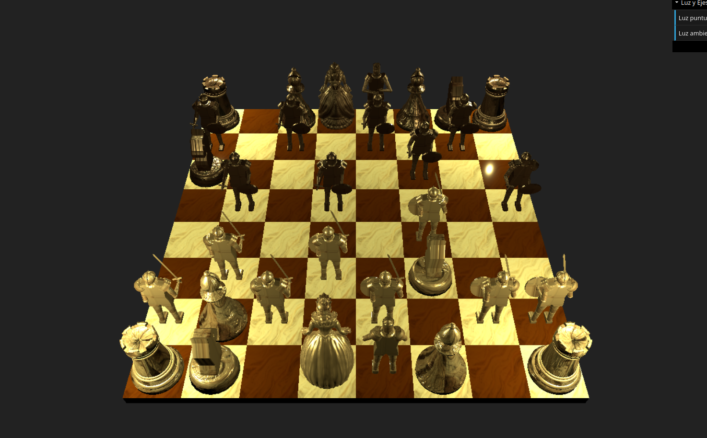
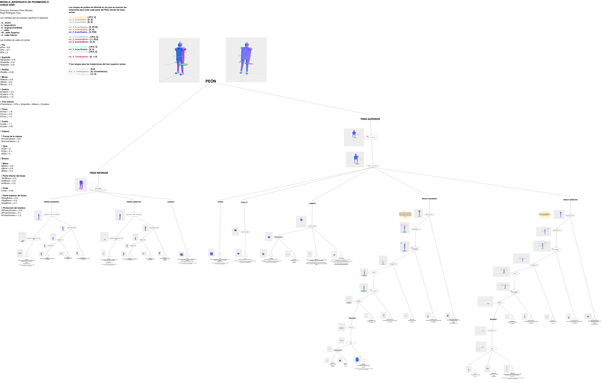
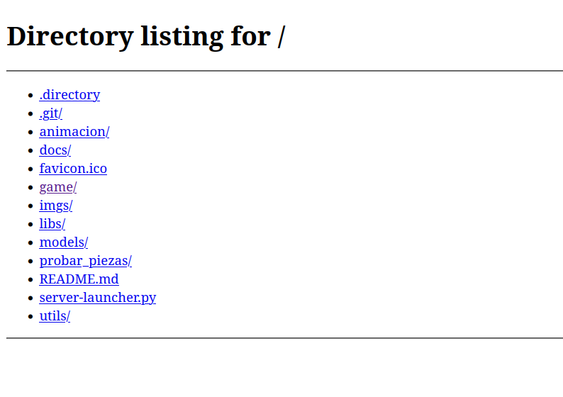

#  CHESS WAR (GUERRA DE AJEDREZ)



  

### Autores
- :bust_in_silhouette:  Ángel Rodríguez Faya :octocat: [http://github.com/AngelRodriguezFaya](http://github.com/AngelRodriguezFaya)
- :bust_in_silhouette:  Francisco Victoriano Pérez Morales :octocat: [https://github.com/fvperezmorales](https://github.com/fvperezmorales)

### Índice

- [1. Descripción sobre el proyecto](#1-descripción-sobre-el-proyecto)
- [2. Demo](#2-demo)
- [3. Características del juego](#3-características-del-juego)
- [4. Estructura del proyecto](#4-estructura-del-proyecto)
- [5. Diseño y arquitectura técnica](#5-diseño-y-arquitectura-técnica)
  - [5.1. Modelo 3D](#51-modelo-3d)
  - [5.2. Lógica del juego](#52-lógica-del-juego)
  - [5.3. Flujo de una jugada](#53-flujo-de-una-jugada)
- [6. Modelado 3D con Three.js](#6-modelado-3d-con-threejs)
- [7. Materiales, texturas e iluminación](#7-materiales-texturas-e-iluminación)
  - [7.1. Materiales y texturas](#71-materiales-y-texturas)
  - [7.2. Iluminación](#72-iluminación)
- [8. Animaciones](#8-animaciones)
- [9. Cámara e interacción](#9-cámara-e-interacción)
- [10. Instalación y ejecución del juego](#10-instalación-y-ejecución-del-juego)
  - [10.1. Requisitos previos](#101-requisitos-previos)
  - [10.2. Instalación](#102-instalación)
- [11. Decisiones técnicas y de desarrollo](#11-decisiones-técnicas-y-de-desarrollo)
- [12. Licencia](#12-licencia)

## 1. Descripción sobre el proyecto.

***Chess War*** es un juego basado en *Battle Chess.* Se trata de un juego de ajedrez 3D donde las piezas cobran vida y luchan entre ellas, mezclando así el clásico juego de ajedrez con elementos de acción y estrategia en un entorno 3D.

<div style="text-align: center;">
	
</div>

Está desarrollado utilizando **Three.js**, que es una librería y API de JavaScript que nos permite crear y mostrar gráficos animados 3D en un navegador web. Fue creada y liberada por Ricardo Cabello en 2010. La podemos eccontrar en su repositorio de GitHub: [Three.js en GitHub](https://github.com/mrdoob/three.js.git)

El **objetivo de este proyecto** es sintetizar los conocimientos adquiridos en la asignatura de Sistemas Gráficos, del Grado en Ingeniería Informática en la Universidad de Granada.

## 2. Demo.

En el siguiente enlace podemos ver una demostración del juego.

🎥 [Ver vídeo de demostración de ejecución](docs/recursos/videos/ejemplo-de-ejecucion.mp4)

También podemos descargar el proyecto y ejecutarlo en nuestro propio ordenador. Para ello, consultar el apartado [10. Instalación y ejecución del juego](#10-instalación-y-ejecución-del-juego).

## 3. Características del juego.

Las características principales del juego son:

- Tablero de ajedrez 3D interactivo.
- Modelado de piezas mediante primitivas geométricas.
- Uso de operaciones booleanas mediante CSG.
- Modelado mediante revolución, extrusión y barrido.
- Carga de modelos externos en formato `.obj`.
- Selección de piezas mediante interacción con el ratón.
- Visualización de movimientos legales.
- Movimiento animado de las piezas.
- Combates durante las capturas.
- Cambio dinámico de cámara entre jugadores.
- Materiales basados en color y texturas.
- Texturas de relieve mediante mapas bump o normales.
- Iluminación con diferentes colores.
- Iluminación y cámaras dinámicas.

## 4. Estructura del proyecto.

La estructura de carpetas del proyecto es la siguiente:

```
chess_war/
├── animacion/
│	├── index.html
│	└── MyScene.js
├── docs/
│	├── diseño
│	└── recursos
│		├── imagenes
│		└── videos
├── game/
│   ├── MyScene.js
│   ├── index.html
│   ├── logica/
│   └── modelos/
├── imgs/
├── models/
│   └── dama/
├── probar_piezas/
│	├── index.html
│	└── MyScene.js
├── utils/
├── README.md
└── server-launcher.py
```
Respecto a la estructura de carpetas, podemos destacar:

| Carpeta | Descripción |
|---|---|
| `game/` | **Se trata del juego en sí**. Incluye la escena principal y la lógica del juego.|
| `game/logica/` | Reglas de movimiento y comportamiento de las piezas |
| `game/modelos/` | Representación visual de las piezas y del tablero |
| `animacion/` | Pruebas y demostraciones de las animaciones de los peones |
| `probar_piezas/` | Escena para poder visualizar las piezas |
| `imgs/` | Texturas e imágenes utilizadas |
| `models/` | Modelos externos en formato `.obj` y `.mtl` |
| `libs/` | Librerías JavaScript utilizadas |
| `docs/` | Docuemntación del proyecto: Diagramas, documentos de diseño y material adicional |

## 5. Diseño y arquitectura técnica.

La arquitectura del proyecto se basa en la separación de responsabilidades. En primer lugar tenemos la creación/visualización de las piezas y el tablero en 3D, por otro lado encontramos la lógica del juego que define las reglas y movimientos del juego. Finalmente encontramos la configuración de la escena, que incluye cámara, iluminación, inicialización del tablero y la interacción con el usuario.

De esta forma, las reglas del ajedrez pueden calcular los movimientos y validar las jugadas sin depender directamente de los objetos de Three.js, mientras que los modelos visuales se encargan de representar el estado del tablero en la escena.

### 5.1. Modelo 3D

Las clases del directorio `game/modelos/` representan los modelos de las piezas y el tablero creados:

- `TableroModelo` construye el tablero, sus casillas y las piezas de ambos jugadores.
- `CasillaModelo` representa cada una de las 64 casillas.
- `PiezaBaseModelo` es la clase base de las piezas y hereda de `THREE.Object3D`.
- `PeonModelo`, `CaballoModelo`, `AlfilModelo`, `TorreModelo`, `ReinaModelo` y `ReyModelo` construyen los modelos específicos de cada pieza.

Las piezas almacenan también su posición en el tablero y el jugador al que pertenecen. Esto permite relacionar cada objeto 3D con su correspondiente pieza lógica.

### 5.2. Lógica del juego

Las clases del directorio `game/logica/` gestionan las reglas del ajedrez:

- `TableroLogica` mantiene una matriz de 8 × 8 posiciones, controla los turnos, las capturas, el jaque y el enroque.
- `PiezaLogica` define el comportamiento común de las piezas lógicas.
- Las clases `PeonLogica`, `CaballoLogica`, `AlfilLogica`, `TorreLogica`, `ReinaLogica` y `ReyLogica` calculan los movimientos posibles de cada pieza, dependiendo de su tipo y situación en el tablero. Respetando siempre las reglas del ajedrez.
- `Jugada` y `Movimiento` (dentro de `game/logica/Jugada.js`) representan los desplazamientos y la información adicional de una jugada, como una captura o el movimiento asociado al enroque.
- `MovimientosUtils.js` contiene funciones auxiliares para generar y validar movimientos.

Antes de aplicar una jugada, el tablero lógico comprueba que la pieza exista, que el movimiento esté permitido y que no deje al rey del jugador en jaque. Si la jugada es válida, se actualiza la matriz del tablero y se recalcula el estado de jaque.

### 5.3. Flujo de una jugada

El flujo principal de una jugada es el siguiente:

1. El usuario selecciona una pieza mediante el ratón.
2. `THREE.Raycaster` identifica el objeto 3D seleccionado.
3. La lógica calcula los movimientos legales de la pieza.
4. El tablero resalta las casillas disponibles y las casillas que contienen una pieza rival.
5. El usuario selecciona una casilla destino.
6. `TableroLogica` valida la jugada y actualiza el estado lógico.
7. `TableroModelo` ejecuta el desplazamiento o la animación de captura.
8. Se actualiza el turno y la cámara gira hacia la perspectiva del otro jugador.

## 6. Modelado 3D con Three.js.

Las diferentes técnicas que hemos utilizado para modelar las piezas son:
- Instanciación de primitivas.
- Geometría de Sólidos Constructiva (CSG), también llamada Operaciones Booleanas.
- Extrusión
- Barrido
- Revolución
- Cargar un modelo en formato .obj
- Modelos Jerárquicos

Además, hay figuras que tienen **Animaciones**.

A continuación detallaremos más detalles sobre las piezas y como la hemos desarrollado en nuestro juego:

|  Nombre  | Cantidad por jugador | Tiene Animación (Si/No) | Técnicas utilizadas para su modelado en 3D| Breve descripción | 
| :------------: | :------------: | :------------: | :------------: | :------------: |
| Rey  | 1  |  No  | Instanciación de primitivas. Operaciones Booleanas (CSG). Extrusión. Barrido. Revolución. Modelos Jerárquicos. | Se creó reutilizando algunas partes del peón, ya que ambos tienen formas similares, tratando de imitar a caballeros medievales. |
|  Dama |  1  | No  | Cargar un modelo en formato .obj  | Esta pieza se ha realizado cargando un modelo en formato .obj, el cuál se puede ver y descargar desde el siguiente enlace: [Enlace a la figura de la Dama en Free 3D ](https://free3d.com/es/modelo-3d/marionette-queen-v1--45470.html)   |
| Alfiles  | 2 |  No | Instanciación de primitivas. Revolución. Operaciones booleanas (CSG)  | Se creó un perfil en 2D (x, y) y mediante revolución sobre el eje Y se generó el modelo 3D. El resto de detalles se hicieron con instanciación de primitivas básicas y operaciones booleanas. |
| Caballos | 2  | No  | Instanciación de primitivas. Revolución. Extrusión. Operaciones booleanas (CSG)  | La base del caballo se creó mediante revolución. Para la cabeza y el cuerpo, se definió su perfil en 2D y se realizó una operación de extrusión sobre dicho perfil para crear el modelo 3D. El resto de detalles se hicieron con instanciación. |
|  Torres  | 2  | No  | Instanciación de primitivas. Revolución. Operaciones booleanas (CSG)  | La base se creó mediante instanciación de primitivas y el cuerpo de la torre se creó mediante revolución. El resto de detalles se hicieron con instanciación de primitivas básicas y operaciones booleanas. | 
|  Peones  | 8  | Si | Instanciación de primitivas. Operaciones Booleanas (CSG). Extrusión. Barrido. Revolución. Modelos Jerárquicos.  | Se trata de la figura más compleja del tablero, ya que fue creada como un modelo jerárquico y contiene animaciones.  |   |

Para la creación del **peón**, se creó un modelo jerárquico donde cada parte del peón es un objeto independiente y se agrupan en un objeto padre. Esto permite que al mover el objeto padre (es decir, realizar transformaciones geométricas) todas las partes del peón se muevan juntas. Podemos ver su estructura jerárquica en el siguiente diagrama:



Además, esta pieza cuenta con dos animaciones. Para ver dichas animaciones, consultar el apartado [8. Animaciones](#8-animaciones). 

## 7. Materiales, texturas e iluminación.

### 7.1. Materiales y texturas

Los materiales se crean en `TableroModelo` mediante `THREE.MeshPhysicalMaterial`. Se combinan colores base con texturas para diferenciar visualmente el tablero y las piezas:

- Las casillas utilizan la textura de mármol situada en `imgs/marmol.png`.
- Las piezas utilizan la textura de madera situada en `imgs/madera_olivo.png`.
- La textura `imgs/madera_bump.png` se utiliza como `bumpMap` para aportar relieve y mejorar la percepción de volumen.
- Las casillas seleccionadas, las casillas libres y las casillas de captura se identifican mediante colores diferentes.
- Las piezas blancas y negras utilizan colores base distintos sobre la misma textura de madera.

El uso de `MeshPhysicalMaterial` permite controlar propiedades como la rugosidad y el metalizado, obteniendo un mejor resultado que un material basado únicamente en un color plano.

### 7.2. Iluminación

La escena combina una luz ambiental con varias luces puntuales:

- La luz ambiental proporciona una iluminación general y evita que las zonas sin iluminación directa aparezcan completamente negras.
- Una luz puntual adicional se coloca sobre la pieza seleccionada para destacarla visualmente.

La intensidad de la luz ambiental y la potencia de la iluminación principal se pueden modificar desde la interfaz de `dat.GUI`. Además, la luz asociada a la pieza seleccionada se activa y se reposiciona durante la interacción con el tablero.

## 8. Animaciones.

Podemos encontrar tres animaciones en el juego, dos de ellas se realizan entre peones al hacer ataques y la tercera es una animación para cuando una pieza ha sido eliminada del tablero.

Respecto a las animaciones de los peones, encontramos que:
- **La primera animación es un movimiento de ataque**, donde el peón gira su brazo junto a su espada pasando por la mitad del peón enemigo, simulando un ataque el cual corta por la mitad al peón enemigo. 
- **La segunda animación simula un movimiento de muerte**, donde el peón enemigo (el cual ha sido atacado) se parte en dos de forma horizontal, cayendo su tronco o parte superior del cuerpo al suelo, mientras que la parte inferior del cuerpo (piernas) se queda en pie. Tras esto, el peón enemigo desaparece del tablero y el peón atacante se mueve a la posición del peón enemigo.

Ambas animaciones se pueden ver por separado tras ejecutar el juego y abir el directorio `animacion/`, o durante la ejecución del propio juego (directorio `game/`). Para ver como se incia el juego, consultar el apartado [10. Instalación y ejecución del juego](#10-instalación-y-ejecución-del-juego).

También se puede ver un vídeo de demostración de las animaciones en el siguiente enlace: [Vídeo de demostración de las animaciones](docs/recursos/videos/animacion-peon_jaque-pastor.mp4)

Para el resto de piezas, tenemos la tercera animación que se activa cuando son eliminadas, se desplazan hacia arriba y desaparecen, simulando que han sido eliminadas del tablero, y la pieza que las reemplaza se coloca en su posición.

## 9. Cámara e interacción.

La **cámara** del juego es dinámica, ya que cambia de posición dependiendo del jugador que esté realizando el movimiento. Además, la cámara se mueve suavemente entre posiciones para dar un efecto más realista y agradable a la vista.

Respecto a la **interacción con el usuario**, se realiza mediante el ratón, utilizando la librería `THREE.Raycaster` para detectar qué pieza o casilla del tablero ha sido seleccionada. Los pasos para realizar un movimiento son los siguientes:
1. El jugador selecciona una pieza haciendo clic sobre ella.
	*Nota 1:* Si selecciona una pieza por error y no es la que quería mover, puede hacer clic en otra pieza para cambiar la selección. Si hace clic en una casilla vacía, se deseleccionará la pieza seleccionada.
	*Nota 2:* Si el rey del jugador está en jaque, solo podrá seleccionar el rey para moverlo y salir del jaque.
2. Una vez seleccionada la pieza, se muestran sus movimientos legales.
3. El jugador selecciona la casilla a la que quiere mover la pieza y esta se mueve a la casilla seleccionada, realizando la animación correspondiente si es corresponde.
4. Se cambia el turno al otro jugador y la cámara cambia automáticamente el punto de vista para que el jugador pueda ver el tablero desde su perspectiva.

## 10. Instalación y ejecución del juego.

### 10.1. Requisitos previos
Para poder ejecutar el juego, es necesario tener instalado:
- Python 3
- Un navegador web moderno con soporte para WebGL (como Google Chrome o Mozilla Firefox)
- Git (opcional, para clonar el repositorio)

### 10.2. Instalación

1. Existen dos formas de instalar el juego:
	1. **Clonando el repositorio desde GitHub**:
		- Abre una terminal y ejecuta el siguiente comando:
			```bash
			git clone [https://github.com/AngelRodriguezFaya/chess_war.git](https://github.com/AngelRodriguezFaya/chess_war.git)
			```
	2. **Descargando el archivo ZIP del repositorio**:
		- Ve a la página del repositorio en GitHub y haz clic en el botón `Code` y luego en `Download ZIP`. Descomprime el archivo ZIP en tu ordenador.

2. Abre una terminal y navega hasta el directorio raíz del proyecto. 
```bash
cd chess_war
```

3. Ejecuta el servidor web local, utilizando el siguiente comando:
```bash
python3 server-launcher.py
```

4. Abre tu navegador web y ve a la siguiente dirección:
```
http://localhost:8000/
```

5. Llegados a este punto, si todo ha ido bien, deberías ver una págona con la lista de directorios del proyecto, tal y como se muestra en la siguiente imagen:

<div style="text-align: center;">
	
</div>

Ahora, dependiendo de lo que quieras hacer, puedes abrir:
- **El juego completo**, abriendo el directorio `game/`
- **Ver las animaciones de los peones**, abriendo el directorio `animacion/`
- **Visualizar las piezas por separado**, abriendo el directorio `probar_piezas/`

En las siguientes imágenes podemos ver ejemplos de cómo se vería cada una de estas opciones:

Tras abrir el directorio `game/`:
<div style="text-align: center;">
	
</div>

Tras abrir el directorio `animacion/`:
<div style="text-align: center;">
	
</div>

Tras abrir el directorio `probar_piezas/`:
<div style="text-align: center;">
	
</div>

## 11. Decisiones técnicas y de desarrollo.

Durante el desarrollo se tomaron varias decisiones para mantener el proyecto organizado ypara facilitar el mantenimiento del código. Además, se aplicaron buenas prácticas de programación y diseño de software. Algunas de estas decisiones son:

- **Separación entre lógica y representación:** las reglas de movimiento se implementan en `game/logica/`, mientras que la construcción y transformación de los objetos 3D se realiza en `game/modelos/`. Esto evita mezclar cálculos del juego con detalles de renderizado.

- **Uso de clases especializadas:** cada tipo de pieza tiene una clase lógica y una clase de modelo independientes. Así, cada pieza puede tener reglas de movimiento, geometría y animaciones específicas.

- **Representación del tablero mediante una matriz:** `TableroLogica` utiliza una matriz de 8 × 8 para consultar rápidamente el contenido de cada casilla y comprobar los movimientos.

- **Validación antes de modificar el estado:** las jugadas se calculan y validan antes de actualizar el tablero. Esto permite comprobar capturas, jaques y movimientos especiales sin dejar el juego en un estado intermedio.

- **Animaciones desacopladas de la lógica:** la lógica actualiza el estado del juego y el modelo 3D representa visualmente ese cambio mediante `tween.js`. Esta separación permite que una animación no cambie las reglas del movimiento.

- **Reutilización de geometrías:** las geometrías de las piezas se almacenan como propiedades estáticas cuando es posible. De este modo, las piezas del mismo tipo pueden reutilizar la geometría y reducir trabajo innecesario.

- **Escenas independientes de prueba:** `animacion/` y `probar_piezas/` permiten comprobar las animaciones y los modelos sin iniciar la partida completa.

Uno de los principales retos fue sincronizar tres estados diferentes: el estado lógico del tablero, la posición de los objetos 3D y el estado de las animaciones. Para resolverlo, las jugadas se representan mediante las clases `Movimiento` y `Jugada`, y la escena controla la transición entre selección, desplazamiento, animación y cambio de turno.

## 12. Licencia.

La licencia del proyecto es **MIT License**, lo que significa que es de código abierto y se puede utilizar, modificar y distribuir libremente, siempre que se incluya la licencia original y los avisos de copyright. Para más información, consulta el archivo `LICENSE` incluido en el repositorio del proyecto.